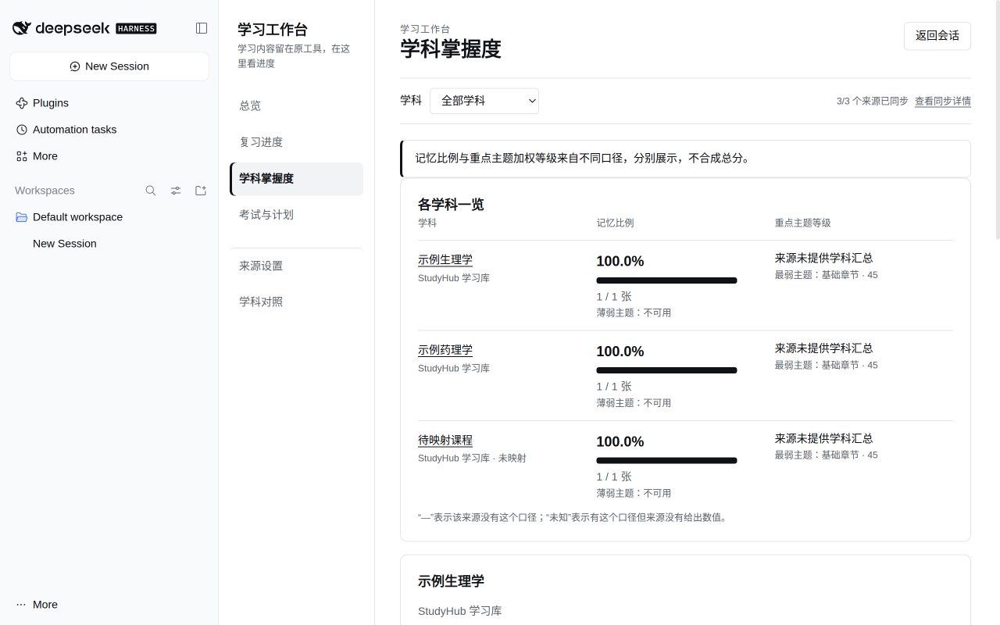
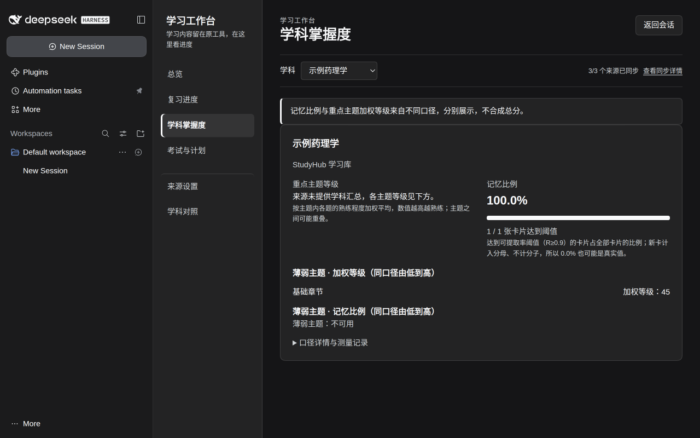

# DSH Learning Workbench

[中文](README.md) | English

A learning dashboard plugin for DeepSeek Harness (DSH). It reads the official StudyHub library and ICS calendars, read-only, and brings reviews, mastery, exams and daily goals together in one DSH panel. Your study material stays in the original tools; the workbench only shows progress.

The interface is in Chinese.



## What it does

A subject filter in the top bar (all subjects / one subject / unmapped) is shared by the four learning views and kept as you switch between them.

- **Overview** (总览): due today and backlog, reviews done today, study streak, upcoming exams, daily goal progress.
- **Review progress** (复习进度): a 14-day forecast of due items in total and per subject, and a monthly review heat calendar.
- **Subject mastery** (学科掌握度): an overview table at the top compares the recall ratio and the focus-topic level of every subject side by side; below it, one card per subject with weak topics, an explanation of each scale and the measurement history.
- **Exams and plans** (考试与计划): a timeline of source and manual exams with countdowns, the daily amount needed from the remaining range, daily review goals, and confirmation of the same exam coming from two sources.
- **Subject mapping** (学科对照): map source courses to local subjects and create or rename subjects, without typing any internal ID.
- **Source settings** (来源设置): add, check, save, sync, disable and delete sources in the panel: a StudyHub library, a local ICS file or a remote ICS link, refreshed manually or on a schedule.



## Design principles

- **Read-only sources**: never writes the StudyHub library or calendar files, and never calls the StudyHub action that writes its board. The workbench writes only its own cache and local choices in DSH storage.
- **Unknown is not zero**: missing data shows as "unavailable" or "unknown", never as 0 reviews or 0% mastery.
- **Two mastery scales, never combined**: the recall ratio (share of cards above the retrievability threshold) and the weighted focus-topic level are shown separately, with no combined score and no ranking across scales.
- **Local access only**: the plugin's own HTTP routes accept loopback connections only and check Host, Origin and a custom request header. This is a local boundary, not user authentication.
- **Plans are suggestions**: daily amounts and goals are never written back to StudyHub or the calendar.

## Requirements

- DSH 0.2.2-rc.2
- Node.js ≥ 24
- For the StudyHub source, the official StudyHub 4.6.0 plugin loaded in the same DSH instance (library format study-sharded v5). Not needed if you only use ICS.

## Installation

The package is not published to npm. Build it from source and install it with DSH's plugin installer:

```sh
npm install --ignore-scripts --legacy-peer-deps --no-package-lock --no-save ical.js@2.2.1
npm pack --ignore-scripts --pack-destination <output-dir>
DSH_HOME=<DSH_HOME> dsh plugin --profile <profile> add <output-dir>/dsh-learning-workbench-0.2.0.tgz --ignore-scripts --config.auto-install-peers=false
```

Back up the profile first. Package checks, upgrading, disabling and rollback are described in [docs/deployment.md](docs/deployment.md) (Chinese).

## Configuration

After installing, open More → 学习工作台 (Learning Workbench) → 来源设置 (source settings), add a source and press 立即同步 (sync now). Saving only validates the configuration and never reads the source; new sources refresh manually by default.

You can also give initial sources for the first start in the profile's `cordis.patch.yml` (all values below are fictional):

```yaml
- id: learning-workbench
  config:
    modules:
      studyhub:
        libraryRoot: /path/to/your-library/.dsh-study
      learning-ics:
        calendars:
          - id: course-file
            title: Course calendar
            path: /path/to/calendars/classes.ics
            timeZone: Asia/Shanghai
          - id: remote-calendar
            title: Remote calendar
            url: https://calendar.example.invalid/private/example.ics
            timeZone: Asia/Shanghai
            intervalMs: 3600000
```

Give either `path` or `url` for each calendar. Once you save in the source settings, the workbench's own settings take over and the profile is no longer imported.

## Development and tests

The toolchain is native ESM on Node 24, `node:test` and the React provided by the host; there is no compiler or bundler.

```sh
npm install --ignore-scripts --legacy-peer-deps --no-package-lock --no-save ical.js@2.2.1
node scripts/test.mjs
```

`scripts/test.mjs` syntax-checks every file under `src`, then runs every `*.test.mjs` under `tests` except `tests/integration`, which needs a real DSH. All tests use fictional data and need no DSH, network or study library.

Front-end preview: run `node scripts/preview/server.mjs` and open <http://127.0.0.1:4780/>. The page fakes the backend with the test fixtures and loads React from esm.sh, so it needs network access; it is not part of the package.

Scripts that verify an upgrade on a real host are in `tests/integration/`; see [docs/deployment.md](docs/deployment.md).

## Layout

```text
src/core/          registration of domains, sources, importers and metrics; snapshot storage, sync state, scheduling
src/host/          DSH integration: storage, HTTP routes and access checks, file/HTTP ports, module discovery
src/ui/            panel shell, view navigation and shared charts
src/domains/learning/
  sources/studyhub/  read-only StudyHub source (including the recall ratio formula)
  sources/ics/       ICS calendar source
  source-settings/   source settings module and view
  metrics/ views/    learning metrics, the four learning views and subject mapping
src/domains/_example/  fictional demo domain (not loaded by default)
src/domains/finance/ health/  reserved, not implemented
tests/             node:test tests and fictional fixtures
scripts/           test runner, package check, front-end preview
docs/              module contract, 0.2 design, deployment notes (Chinese)
```

A new domain or source only needs a `module.mjs` under `src/domains/<domain>/`; the host discovers it recursively without framework changes. The interfaces are in [docs/contracts.md](docs/contracts.md), the 0.2 design decisions in [docs/design-v0.2.md](docs/design-v0.2.md).

## Known limitations

- ICS calendars carry no course-level subject, so ICS exams cannot be mapped in subject mapping; a whole calendar's subject can only be inherited from the profile's `subjectRef`, not edited in the settings.
- Local ICS files must be updated by hand: a refresh re-reads the same file and never fetches a new version from the calendar service.
- By default ICS events are classified as exams or assignments only by the summary prefixes 「学习通考试：」 and 「学习通作业截止：」 (the Chaoxing export format); other formats need `rules` in the profile configuration.
- Remote ICS links cannot use a proxy.
- If the StudyHub library is not study-sharded v5, only what the official actions return is read, and a warning is shown.
- No reminders, notifications or agent tools; the finance and health domains are not implemented.
- Known minor UI issues in 0.2.0: subjects without mastery records do not appear in the mastery overview table and nothing says so; after jumping to a detail card by keyboard, the card's top edge sits flush with the viewport; after confirming a delete, focus does not return to a sensible place on the page; a source that failed before shows "syncing" in red when synced again; the sync success message appears 1–3 seconds before the time updates.

## Privacy

- The workbench calls no model and uploads nothing; records and local choices stay in DSH storage on your machine.
- Private remote ICS links are kept in the backend only: the settings show "configured", and the link never appears in the panel, status, error messages or logs.
- Source errors are reported with fixed codes and messages, never with raw exceptions that might contain a path or link.
- Question text, answers and feedback from StudyHub are not copied; only the fields needed for reviews, due items and mastery are read.

## License and third parties

Released under the [MIT License](LICENSE).

- The recall ratio formula in `src/domains/learning/sources/studyhub/ratio.mjs` is extracted from StudyHub 4.6.0 `lib/sm2.js` by Eric Wang, MIT licensed; the original copyright notice is kept in [STUDYHUB-LICENSE.txt](src/domains/learning/sources/studyhub/STUDYHUB-LICENSE.txt) next to it.
- The runtime dependency [ical.js](https://github.com/kewisch/ical.js) 2.2.1 (MPL-2.0) is not in this repository; packaging bundles it through `bundleDependencies`, with its LICENSE.
- StudyHub and DSH are projects of their respective authors. This plugin only reads data through their public interfaces and is not affiliated with them.

See [CHANGELOG.md](CHANGELOG.md) for release notes.
