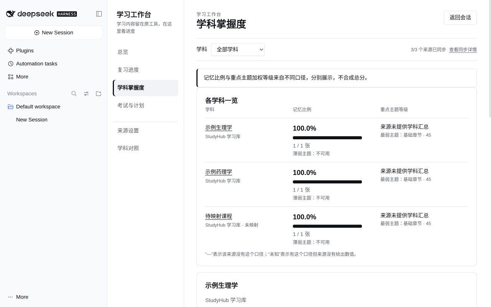
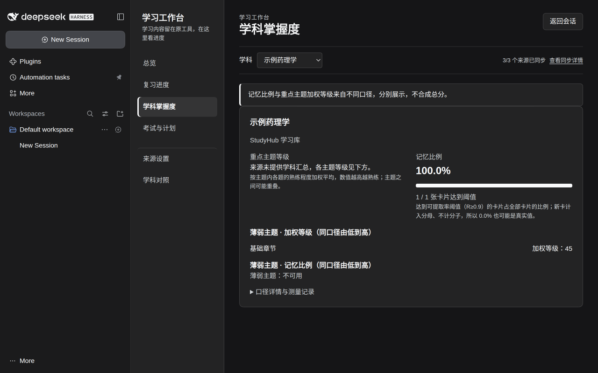

# DSH 学习工作台

中文 | [English](README.en.md)

DeepSeek Harness（DSH）的学习面板插件。它只读地接入官方 StudyHub 学习库和 ICS 日历，把复习、掌握度、考试和每日目标汇总在 DSH 的一个面板里。学习内容仍留在原工具，工作台只负责看进度。



## 能做什么

面板顶栏有统一的学科筛选（全部学科 / 某一学科 / 未映射学科），在四个学习视图之间保持选择。

- **总览**：今日到期与欠账、今日已复习次数、连续学习天数、最近考试、每日目标完成情况。
- **复习进度**：未来 14 天到期量合计图与分学科小图，每月复习热力日历。
- **学科掌握度**：页首「各学科一览」把各学科的记忆比例和重点主题等级并排比较；下方每个学科一张详情卡，含薄弱主题、口径说明和测量记录。
- **考试与计划**：来源考试和手工考试的时间线、倒计时，按剩余题量算出的每日需要量，每日复习目标，跨来源同一场考试的去重确认。
- **学科对照**：把来源课程映射到本地学科，新建或改名学科，不需要填写任何内部 ID。
- **来源设置**：在面板里添加、检查、保存、同步、停用和删除来源。支持 StudyHub 学习库、本地 ICS 文件和远程 ICS 链接，手动或定时刷新。



## 设计原则

- **只读来源**：不写 StudyHub 学习库，不写日历文件，也不调用会写看板的 StudyHub action。工作台只写自己在 DSH 存储里的缓存和本地选择。
- **未知不当 0**：没有数据时显示「不可用」或「未知」，不把缺失当成 0 次复习或 0% 掌握。
- **两种掌握度口径不合成**：记忆比例（达到可提取率阈值的卡片占比）和重点主题加权等级分开展示，不合成总分，不跨口径排序。
- **只接受本机访问**：插件自己的 HTTP 路由只接受回环连接，并校验 Host、Origin 和自定义请求头；这是本机边界，不是用户身份认证。
- **计划只是建议**：每日需要量和目标不会写回 StudyHub 或日历。

## 环境要求

- DSH 0.2.2-rc.2
- Node.js ≥ 24
- StudyHub 来源需要同一 DSH 实例加载官方 StudyHub 4.6.0 插件（学习库为 study-sharded v5）；只用 ICS 时不需要。

## 安装

本项目不发布到 npm，从源码打包后用 DSH 的插件安装入口安装：

```sh
npm install --ignore-scripts --legacy-peer-deps --no-package-lock --no-save ical.js@2.2.1
npm pack --ignore-scripts --pack-destination <输出目录>
DSH_HOME=<DSH_HOME> dsh plugin --profile <profile> add <输出目录>/dsh-learning-workbench-0.2.0.tgz --ignore-scripts --config.auto-install-peers=false
```

安装前请备份 profile。包校验、升级、禁用和回滚见 [docs/deployment.md](docs/deployment.md)。

## 配置

装好后打开 More → 学习工作台 → 来源设置，添加来源并点「立即同步」。保存只校验配置，不会读取来源；新来源默认手动刷新。

也可以在 profile 的 `cordis.patch.yml` 里给出首次启动时的初始来源（以下均为虚构值）：

```yaml
- id: learning-workbench
  config:
    modules:
      studyhub:
        libraryRoot: /path/to/your-library/.dsh-study
      learning-ics:
        calendars:
          - id: course-file
            title: 课程日历
            path: /path/to/calendars/classes.ics
            timeZone: Asia/Shanghai
          - id: remote-calendar
            title: 远程日历
            url: https://calendar.example.invalid/private/example.ics
            timeZone: Asia/Shanghai
            intervalMs: 3600000
```

每个日历 `path` 和 `url` 只填一个。第一次在来源设置里保存后，以工作台自己的设置为准，不再自动导入 profile。

## 开发与测试

工具链是 Node 24 原生 ESM、`node:test` 和宿主提供的 React，没有编译器或打包器。

```sh
npm install --ignore-scripts --legacy-peer-deps --no-package-lock --no-save ical.js@2.2.1
node scripts/test.mjs
```

`scripts/test.mjs` 先检查 `src` 下所有文件的语法，再运行 `tests` 下的 `*.test.mjs`（不含需要真实 DSH 的 `tests/integration`）。测试全部使用虚构数据，不需要 DSH、网络或学习库。

前端预览：`node scripts/preview/server.mjs`，再打开 <http://127.0.0.1:4780/>。预览页用测试夹具模拟后端，从 esm.sh 加载 React，所以需要联网；它不进发行包。

在真实宿主上验证升级的脚本在 `tests/integration/`，用法见 [docs/deployment.md](docs/deployment.md#宿主集成测试)。

## 目录结构

```text
src/core/          领域、来源、导入器和指标的登记；快照存储、同步状态与调度
src/host/          DSH 接入：存储、HTTP 路由与访问边界、文件/HTTP 端口、模块发现
src/ui/            面板外壳、视图导航和共用图表
src/domains/learning/
  sources/studyhub/  StudyHub 只读来源（含记忆比例公式）
  sources/ics/       ICS 日历来源
  source-settings/   来源设置模块与视图
  metrics/ views/    学习指标与四个学习视图、学科对照
src/domains/_example/  演示用的虚构领域（默认不加载）
src/domains/finance/ health/  预留目录，尚无实现
tests/             node:test 测试与虚构夹具
scripts/           测试入口、包校验、前端预览
docs/              模块契约、0.2 设计、部署说明
```

新增领域或来源只需在 `src/domains/<领域>/` 下放一个 `module.mjs`，宿主会递归发现，不需要改框架代码。接口见 [docs/contracts.md](docs/contracts.md)，0.2 的设计取舍见 [docs/design-v0.2.md](docs/design-v0.2.md)。

## 已知限制

- ICS 日历没有课程级的学科信息，ICS 考试不能在学科对照里映射；整份日历的学科只能通过 profile 配置的 `subjectRef` 继承，设置页不能修改。
- 本地 ICS 文件需要自己更新，刷新只重新读取同一个文件，不会向日历服务获取新版本。
- ICS 默认只把以「学习通考试：」「学习通作业截止：」开头的事件识别为考试和作业（超星学习通导出格式）；其他格式需要在 profile 配置 `rules`。
- 远程 ICS 不支持代理设置。
- StudyHub 学习库不是 study-sharded v5 时，只读取官方 action 能给出的数据，并显示提示。
- 没有提醒、通知或 agent 工具；财务和健康领域尚未实现。
- 0.2.0 已知的界面小问题：没有掌握度记录的学科不会出现在「各学科一览」里，也没有说明；键盘跳到详情卡后，卡片顶边贴着视口；确认删除后焦点没有回到页面上的合适位置；之前同步失败的来源再次同步时，「同步中」显示为红色；同步成功的提示会比时间更新早 1–3 秒出现。

## 隐私

- 工作台不调用模型，不上传任何数据；记录和本地选择只存在本机 DSH 的存储里。
- 远程 ICS 私密链接只保存在后端：设置页只显示「已配置」，链接不会出现在面板、状态、错误信息或日志中。
- 来源错误只以固定的错误码和文案公开，不透传可能包含路径或链接的原始异常。
- 不复制 StudyHub 的题干、答案和评语，只读取复习、到期和掌握度所需的字段。

## 许可证与第三方

本项目以 [MIT 许可证](LICENSE) 发布。

- `src/domains/learning/sources/studyhub/ratio.mjs` 中的记忆比例公式提取自 StudyHub 4.6.0 的 `lib/sm2.js`，原作者 Eric Wang，MIT 许可；原版权声明保留在同目录的 [STUDYHUB-LICENSE.txt](src/domains/learning/sources/studyhub/STUDYHUB-LICENSE.txt)。
- 运行依赖 [ical.js](https://github.com/kewisch/ical.js) 2.2.1（MPL-2.0）不在本仓库中；打包时通过 `bundleDependencies` 随包携带，包内保留其 LICENSE。
- StudyHub 和 DSH 是各自作者的项目，本插件只通过它们公开的接口读取数据，与其作者无隶属关系。

更新记录见 [CHANGELOG.md](CHANGELOG.md)。
